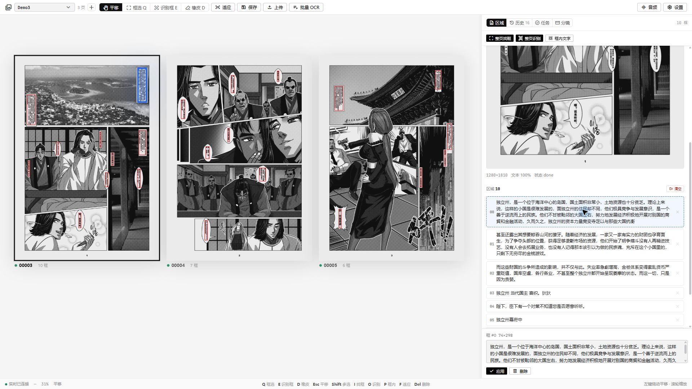
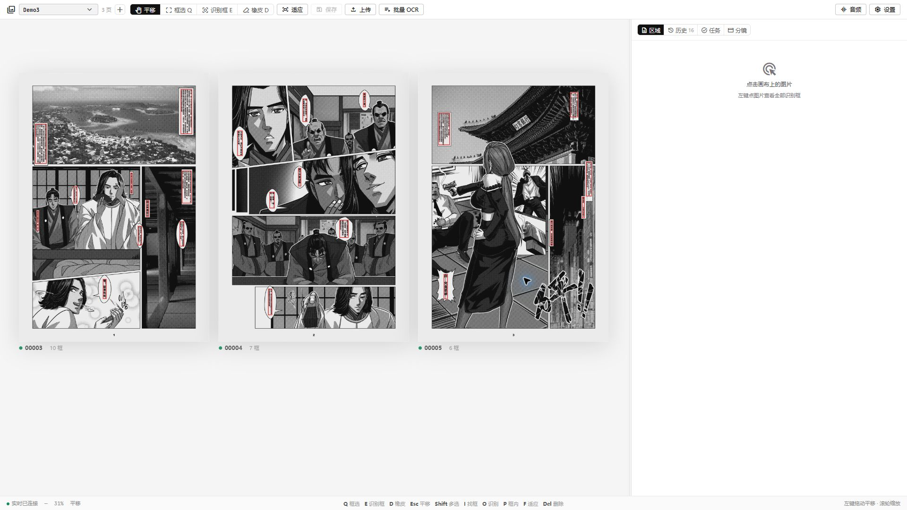
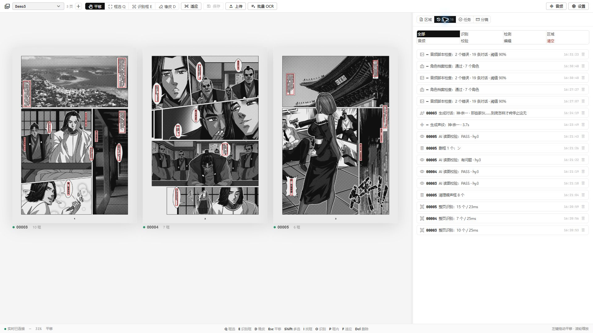
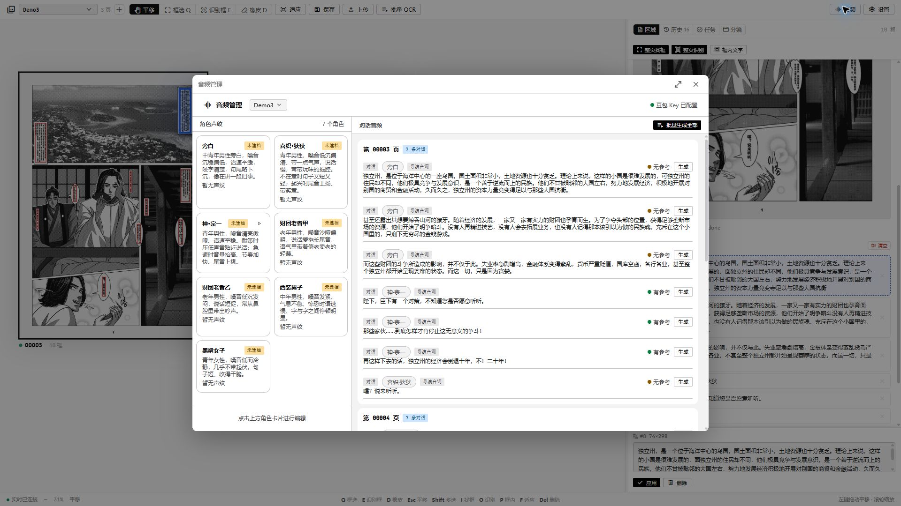
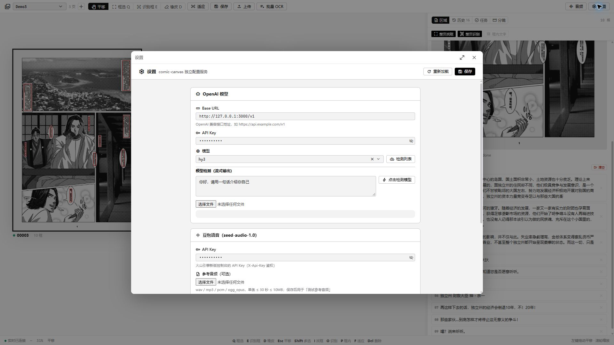

# 漫画分镜工作室 · manga-panel-studio

无限画布式的漫画 OCR 校对与配音流水线：漫画页平铺在画布上，文字框跟着图片缩放、平移；
AI 通过 HTTP 接口改框，前端用 SSE 实时刷新。一张漫画从「识别」到「能配音」的全过程，
都能在一个页面里看见、改掉、回滚。



前端是原生 HTML/JS，没有构建步骤；画布服务是 Node 单文件；识别服务是 Python。
第三方库（Vue、marked、字体）都已本地化，断网也能用。

## 它能做什么

| 能力 | 说明 |
| --- | --- |
| 无限画布 | 多页漫画平铺，滚轮缩放、左键拖动，框自动跟随 |
| 框选与多选 | Shift 拖动框选、Shift 点选加减；主框与附加框用不同边框区分 |
| 整页 / 区域 / 框内识别 | 三种粒度走同一个任务队列，失败可重试 |
| 逐页校对 | 红色标记框 + 坐标刻度，AI 读图判断漏框、噪声框、空框 |
| 历史与回滚 | 每次改框、识别、配音都留记录，带中间图，可还原到那一步 |
| 分镜稿 | 读 `sessions/<画布>/NNNNN.md`，渲染成镜头卡片与台词表 |
| 配音脚本 | AI 按分镜写 `audio_scripts.json`，含情绪、配乐、音效提示 |
| 声纹与对话音频 | 豆包 `seed-audio-1.0` 生成角色声纹和每句对话，结果写回历史 |
| 静态自检 | 音频脚本覆盖率、角色档案完整性，结论同样进历史 |

## 界面

| 主画布 | 右侧区域面板 |
| --- | --- |
|  |  |

| 历史记录 | 音频管理 |
| --- | --- |
|  |  |

设置页里配置模型与密钥，音频页里管理角色声纹和每页对话：



顶栏右侧固定为「音频 → 设置」，快捷键提示固定在底部状态栏正中：


## 快速开始

当前版本面向 Windows 本地使用。需要 Node.js，以及一个装了 `manga-image-translator` 的 Python 环境。

```powershell
git clone <your-repo> manga-panel-studio
cd manga-panel-studio
```

把 `start.bat` 里的 Python 路径改成你自己的：

```bat
set "OCR_PY=I:\manga-image-translator\py310\python.exe"
```

然后双击 `start.bat`，它会同时拉起两个服务：

```text
画布服务   node server/canvas.mjs                  http://127.0.0.1:7788
识别服务   python server/ocr_service.py --port 5009
```

首次启动要加载 OCR 模型，`/health` 可能 1–3 分钟才通，属正常现象，不要重复启动。

## 快捷键

| 键 | 作用 | 键 | 作用 |
| --- | --- | --- | --- |
| `Q` | 框选 | `E` | 识别框 |
| `D` | 橡皮 | `Esc` | 回到平移 |
| `Shift` | 多选 | `I` | 整页找框 |
| `O` | 整页识别 | `P` | 框内文字 |
| `F` | 适应窗口 | `Del` | 删除选中框 |

## 目录结构

```text
manga-panel-studio/
├── server/                 后端
│   ├── canvas.mjs          画布服务（Node，7788）
│   ├── tool_routes.js      设置 / 音频路由
│   ├── tools_helpers.js    设置读写、豆包、角色档案
│   ├── ocr_service.py      识别服务（Python，5009）
│   ├── mask_column_ocr.py  按列切分的识别算法
│   ├── draw_boxes.py       历史图绘制
│   └── render_check.py     校对图渲染
├── public/                 前端（原生 JS，无构建）
│   ├── index.html          主页面
│   ├── canvas.js           画布与交互逻辑
│   ├── panel.html          右侧面板模板
│   ├── settings.html       设置页
│   ├── audio.html          音频管理页
│   └── vendor/             Vue、marked、字体（离线可用）
├── skills/                 AI 技能
│   └── manga-panel-studio/
│       ├── SKILL.md        流程说明
│       └── scripts/        命令行工具
├── sessions/               画布数据（会话、图片、历史、音频）
├── docs/                   文档与截图
└── scripts/                协作与自检脚本
```

## 给 AI 用的接口

画布服务把「改框」做成普通 HTTP，任何脚本都能调用：

```text
GET    /api/sessions                          列出画布
POST   /api/sessions                          新建画布
GET    /api/session/:name                     画布全部页与框
GET    /api/session/:name/page/:page          单页框数据
PUT    /api/session/:name/page/:page          覆盖该页框（自动写历史）
POST   /api/session/:name/job                 投递识别任务
GET    /api/jobs                              任务队列状态
GET    /events                                SSE：画布变动实时推送
```

配套的命令行工具在 `skills/manga-panel-studio/scripts/canvas_cli.py`，
封装了建画布、上传、识别、改框、校验、配音等流程。它只通过上面的 HTTP 接口写数据，
不直接改 `sessions/` 里的 JSON，保证历史记录和前端刷新不会漏。

## 安装为 AI 技能

目标是用一条命令装进 Codex / Claude Code 等支持 Agent Skills 的工具：

```bash
npx skills add <owner>/manga-panel-studio --skill manga-panel-studio
```

现状与限制，请先读 [docs/skill-install-plan.md](docs/skill-install-plan.md)：

- 技能安装器只复制技能目录本身，**不会**安装 `server/`、`public/` 和 Python 环境；
- 所以画布应用要另外安装（npm 包或克隆仓库），技能负责「启动 + 调用」；
- 用户数据（`sessions/`、`settings.json`）要放用户目录，不能留在安装目录里。

这份方案把改造拆成了可逐步验证的阶段，目前尚未实施。

## 数据放在哪

现在版本的数据都在项目目录里，适合单机使用：

```text
sessions/<画布>/            图片、框 JSON、历史、音频
settings.json               模型地址、密钥、豆包配置（已被 .gitignore 忽略）
```

`settings.json` 含密钥，所以仓库只提供 `settings.example.json`。
克隆后第一次打开设置页，按提示填自己的配置即可。

## 已知限制

- 目前是 Windows 本地版：`start.bat`、OCR 的 Python 路径、校对图字体都按 Windows 写。
- 识别服务依赖 `manga-image-translator` 与模型权重，体积较大，不随仓库分发。
- 端口固定为 7788 / 5009，暂未提供修改方式。

## 文档

- [技能安装改造方案（含名字候选）](docs/skill-install-plan.md)
- [安装规范调研](docs/research-skill-install.md)
- [多人协作规则](docs/coordination.md)
- [UI 组件说明](docs/uikit_readme.md)
